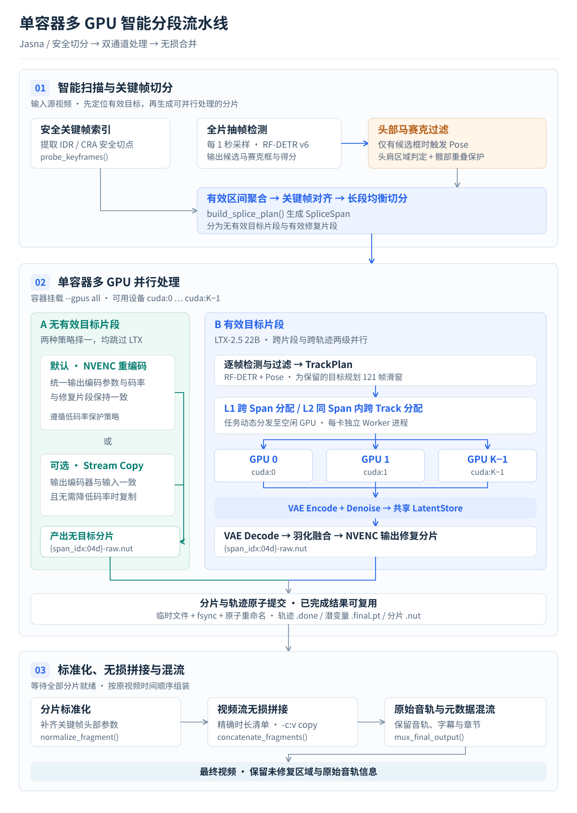
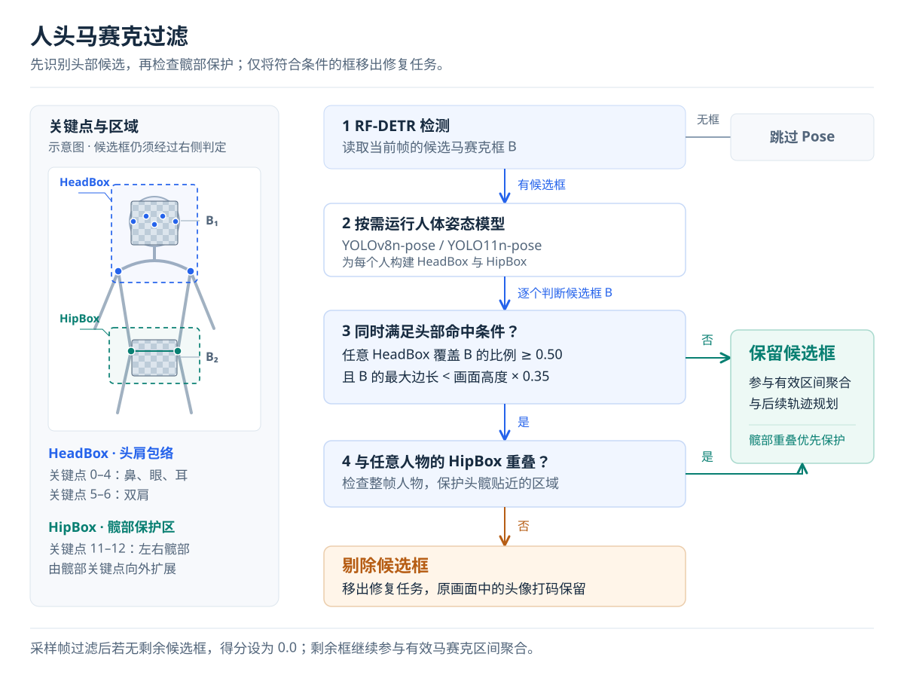

# Jasna 单容器多 GPU 智能分段与人头马赛克剔除架构设计

- 负责人：Mengsk
- 助手：Gemini（设计文档、T1~T9 实施与真机验证）、Codex（图示重绘与验证）、Claude（技术方案审阅与 T6~T8 修订）
- 评审人：Mengsk（已批准，2026-10-28）
- 图示审阅：重绘版待 Mengsk 审阅（2026-10-28）
- 技术审阅：Claude 审阅模型选型与性能，修订意见见[第 7 节](#7-技术审阅与修订记录)（2026-10-28）
- 编制日期：2026-10-28
- 适用版本：`v0.12.0` 及后续版本

## 1. 当前依据

- [jasna/mosaic_scan.py](../jasna/mosaic_scan.py)：全片抽帧马赛克扫描与时间区间聚合实现，作为第一阶段极速扫描的基础模块。
- [jasna/media/splice.py](../jasna/media/splice.py)：安全随机访问关键帧探测、智能分段切分计划构建及 FFmpeg 无损混流拼接实现。
- [jasna/pipeline.py](../jasna/pipeline.py)：离线视频修复主控流水线，包含完整重编码与智能分段渲染调度入口。
- [jasna/ltx/restore.py](../jasna/ltx/restore.py)：LTX-2.5 22B 四阶段修复流水线与磁盘级中间潜变量存储实现。
- [jasna/ltx/inference.py](../jasna/ltx/inference.py)：LTX 受保护推理子进程客户端与跨设备张量通信边界。
- [jasna/ltx/plan.py](../jasna/ltx/plan.py)：帧内马赛克区域聚类、跨帧轨迹关联与 121 帧滑窗规划算法。
- [jasna/mosaic/rfdetr.py](../jasna/mosaic/rfdetr.py)：RF-DETR v6 TensorRT 检测模型推理与全片快速扫描接口。
- [jasna/mosaic/head_filter.py](../jasna/mosaic/head_filter.py)：姿态关键点人头马赛克剔除实现，判定阈值以此为准。
- [jasna/multi_gpu.py](../jasna/multi_gpu.py)：单容器多 GPU 分段调度、L1/L2 并行、尾部空窗重叠与逐卡精度选择实现。
- [jasna/runtime_log.py](../jasna/runtime_log.py)：单文件结构化运行日志与四类核心指标摘要实现。
- [docs/Bugs.md](./Bugs.md)：历史解码器时序与边缘融合缺陷归档，约束分片与拼接时的时间戳连续性。

## 2. 背景与核心痛点

### 2.1 单视频单卡算力瓶颈

当前生产环境虽具备多张 RTX 4090 / RTX 5090 显卡，但单个 Jasna 进程全局仅绑定单一 `--device`（如 `cuda:0`）。当处理单部超长视频（如 120 分钟以上 1080p/4K 影片）或批次尾声仅剩单个大文件时，其余 GPU 处于闲置状态，无法协同缩短单部视频的端到端交付时间。

### 2.2 无马赛克片段的全量计算浪费

在默认全片修复模式下，前戏访谈、转场空镜及无马赛克剧情片段仍会逐帧解码并流经完整流水线。若能在前置阶段自动识别出含有效马赛克的关键帧区间，跳过无马赛克画面，可直接削减大量无效解码与修复耗时。

### 2.3 男优与路人头像打码引发的算力翻倍与伪影

现有检测模型（`rfdetr-v6-large`）属于单类别纹理检测器，会将画面中的男优脸部打码、街头路人打码与核心私密部位马赛克一并检出：

1. **算力翻倍消耗**：在同框画面中，上方的男优头像马赛克与下方的核心马赛克空间不重叠，会被规划为两条独立的 `TrackPlan`，导致 LTX 22B 模型需要额外计算一倍的 121 帧滑窗。
2. **纯对话片段误触发**：仅包含男优或路人头像打码的访谈片段会被误判为待修复区间送入 LTX。
3. **五官恐怖谷伪影**：LTX 修复权重专为私密部位训练，强行修复人脸马赛克会产生扭曲的五官伪影。

## 3. 总体业务流程设计

### 3.1 端到端三级流水线架构图

### 3.2 三阶段核心职责对照

| 流水线阶段                     | 核心职责概述                                                                                                  |
| ------------------------------ | ------------------------------------------------------------------------------------------------------------- |
| Stage 1：智能扫描与关键帧切分  | 探测全片安全 I 帧，按 1 秒步长极速抽帧检测，剔除男优头像打码，对齐关键帧生成无码快编段与有效修复大块          |
| Stage 2：单容器多 GPU 并行处理 | 有码大块由容器内多张 GPU 并发渲染；无码段在各卡尾部等待空窗内执行 NVENC 极速硬压，实现双通道时间重叠          |
| Stage 3：FFmpeg 无损混流合并   | 多线程注入关键帧头信息标准化为 `.ts` 分片，按精确清单执行 `concat` 无损合并并统一封装为 `.mp4`（`HEVC/hev1`） |

## 4. 关键技术方案细化

### 4.1 男优与路人头像马赛克剔除机制

#### 4.1.1 姿态关键点过滤决策流

#### 4.1.2 判定准则与防误杀保护

利用镜像环境已内置的 `ultralytics` 运行时加载人体关键点模型 `yolo26s-pose`（免 NMS，COCO-pose mAP50-95 为 63.0，高于 `yolov8n-pose` 的约 50；下载失败时回退已缓存的 `yolov8n-pose`），仅在 `RF-DETR` 检出候选马赛克框的帧上按需触发。帧画面先在 GPU 上缩放到长边 640 再拷回主机送入模型，避免整帧 1080p/4K 跨 PCIe 传输与 CPU 缩放：

1. **头肩区域构建（HeadBox）**：提取单人头部关键点（`0: Nose`, `1~2: Eyes`, `3~4: Ears`）与双肩关键点（`5~6: Shoulders`），推导包含头颅与面部的包络框。由于姿态模型依赖头肩轮廓与躯干拓扑，即使面部完全被打码仍能稳定定位。
2. **髋部核心区构建（HipBox）**：提取单人左/右髋部关键点（`11~12: Hips`）并向外扩展形成核心保护区。
3. **三级过滤判定**：
   - **命中条件**：候选马赛克框 $B_{\text{mosaic}}$ 被任意人物 `HeadBox` 覆盖的比例 $\text{Cover}(\text{HeadBox}, B_{\text{mosaic}}) \ge 0.45$，且马赛克框最大边长小于画面高度的 $35\%$。
   - **近景互动防误杀保护**：若 $B_{\text{mosaic}}$ 被画面中任意人物的 `HipBox` 覆盖的比例 $\ge 0.12$（如近景接触互动镜头），强制触发保护并保留该框。
   - **几何双框兜底**：未匹配任何 `HeadBox` 时，若马赛克框中心位于画面上方 $36\%$、近似方形且最大边长小于画面高度的 $20\%$，同时其下方存在面积至少 $1.35$ 倍的另一马赛克框，按人头马赛克处理。
   - **剔除动作**：满足命中条件且未触发髋部保护的纯人头马赛克框直接丢弃；若某采样帧丢弃后无剩余框，该帧得分置为 `0.0`。

### 4.2 Stage 1：无码画面跳过与关键帧均衡分片

1. **安全切点提取**：调用 [jasna/media/splice.py](../jasna/media/splice.py) 中的 `probe_keyframes()`，获取全片所有 IDR / CRA 安全关键帧时间戳。
2. **有效区间聚合**：对通过人头马赛克过滤后的采样得分序列调用 `segments_from_scores()`，生成仅包含目标马赛克的时间区间。纯无码画面以及仅有男优头像打码的片段自动归入未选中区间。
3. **按卡归并渲染大块（任务级加载 LTX）**：将有效马赛克区间归并为少量连续渲染大块，目标约每张 GPU 3 块，每块由一个 worker 子进程处理，LTX 在块内只加载一次：先完成 Pass 1 预扫描（此时不驻留 LTX），再依次加载 VAE 编码器、22B Transformer、解码器处理块内全部滑窗，块结束后释放。归并与切分规则：
   - 不超过 `MULTI_GPU_MAX_INNER_GAP`（默认 `35` 秒）的短无码过渡保留在块内，由 worker 在 Pass 1 扫描后直接跳过 LTX 2/3/4；超过 `35` 秒的长无码区间拆出走通道 A（`82.6x` NVENC 硬件快速重编码通道），避免长无码段在 worker 内逐帧检测。
   - 单块目标工作量取“总马赛克时长 /（GPU 数 × 3）”与 120 秒中的较大者，超过目标 1.25 倍的块按目标切分，再由主进程按工作量降序分配给空闲 GPU。切点只取无码间隙或前后 1 秒采样均无马赛克的安静关键帧；找不到安全切点时不切，绝不在连续马赛克中间切开。

### 4.3 Stage 2：单容器多 GPU 双层并发与尾部空窗重叠调度

容器通过 `--gpus all` 挂载宿主机全部可用显卡（`cuda:0` 至 `cuda:K-1`），内部采用双通道尾部空窗重叠与两级并行机制：

#### 4.3.1 通道 A：无马赛克片段极速处理与尾部空窗重叠（Tail-Idle-Window Overlap）

- **统一目标码率模式（默认推荐，如 `HEVC 5M`）**：无马赛克片段跳过 LTX 模型，通过绑定独立物理 GPU（`CUDA_VISIBLE_DEVICES=<phys_gpu>`，满足 PyAV `CudaContext(device_id=0)` 约束）的子进程直接执行 NVENC 硬件重编码，输出与渲染片段参数完全一致的分片。
- **尾部空窗重叠执行**：每张 GPU 优先执行分配给本卡的通道 B（LTX 渲染大块）；当某张 GPU 率先完成本卡最后一块 LTX 大块而其余 GPU 仍在收尾时，立即在该卡的尾部等待空窗内执行本卡分担的无码段 NVENC 快编，将通道 A 的独立墙钟耗时完全掩蔽。
- **原编码流复制模式（Stream Copy）**：当输出编码器与输入源一致且无需压降码率时，直接调用 `create_copy_fragment()` 进行零重编码数据包复制。

#### 4.3.2 通道 B：有效马赛克片段多 GPU 协同渲染

针对 `pending_ltx` 渲染任务，结合视频马赛克分布特征实施两级并行：

1. **L1 跨片段并行（Span-Level Parallelism）**：
   - 主进程将第 4.2 节第 3 条归并出的渲染大块按帧数降序排队，为每张 GPU（`cuda:0 .. cuda:K-1`）分配独立工作线程，每块启动一个 worker 子进程并行渲染，并在渲染完成后直接调用 `normalize_fragment()` 归一化为 `{span_idx:04d}.ts`（省去冗余 `.nut` 中转拷贝）。
   - **逐卡精度选择**：开启 `LTX_FAST` 时，仅 Blackwell 架构（RTX 5090）使用 NVFP4 权重，RTX 4090 等不支持的显卡自动回退 INT8 权重；分段预扫描的续跑指纹随该卡精度生成，与 worker 子进程保持一致。
2. **L2 跨轨迹并行（Track-Level Parallelism）**：
   - 当遇到单段超长连续马赛克（或同屏多轨迹）时，在 [jasna/ltx/restore.py](../jasna/ltx/restore.py) 的 `_restore_spans` 内部实例化 $K$ 个绑定不同物理显卡的 `ModelRuntime`（每个实例对应一个独立的 `--ltx-worker` 子进程，独占各自的 `cuda:i`）。
   - 在 `encode`（VAE 编码）与 `denoise`（22B Transformer 去噪）阶段，将 `PreparedSpan` 中的各个 `TrackPlan` 动态分发给空闲 GPU Worker 并发执行，生成的 `*.final.pt` 通过 `atomic_write` 汇总至共享 `LatentStore` 目录。
   - 协作卡只从与主卡精度相同的空闲 GPU 中选取，避免同一分段内不同轨迹混用 INT8 与 NVFP4 导致观感不一致。

### 4.4 Stage 3：FFmpeg 无损混流、断点续跑与统一 `.mp4`（`HEVC/hev1`）输出

1. **分片级断点续跑**：每个 `{span_idx:04d}.ts`、无码 `{span_idx:04d}-raw.nut` 与每条 LTX 轨迹 `{track_id}.done` 均采用写临时文件加 `fsync` 原子重命名提交。任务中途中断重启后，已落盘分片与已完成轨迹潜变量全部秒级复用跳过。
2. **多线程标准化与统一 MP4 混流**：通过 `ThreadPoolExecutor(max_workers=8)` 并行将剩余无码分片标准化为 MPEG-TS（`.ts`），再调用 `concatenate_fragments()` 执行 `ffmpeg -f concat -safe 0 -c:v copy` 无损拼合视频轨，混流原片音轨与章节信息，并统一封装为带 `-tag:v hev1 -movflags +faststart` 的 `.mp4`（`-U.mp4`）输出文件。

### 4.5 单文件结构化运行日志（`jasna/runtime_log.py`）

为支撑生产批量运行审计与性能复盘，每次运行仅生成一个按运行编号隔离的日志文件 `$LOG_DIR/<RUN_ID>/jasna.log`，终端与文件共享完全相同的单行前缀格式 `<YYYY-MM-DD HH:MM:SS> Jasna <任务标识> [<序号>/<总数>] <阶段> <详情>`，并原生输出四类结构化指标摘要：

1. **片源与目标基本信息（`任务开始` / `处理目标`）**：输出输入分辨率、帧率、总帧数、时长、视频流码率（含来源）、容器总码率（含来源）、十进制文件大小（`MB/GB`），以及输出 `.mp4` 路径、目标编码器（`hevc_nvenc`）、码率上限策略与多卡配置。
2. **Stage 1 分析时间与免处理占比（`[Stage 1 分析汇总]`）**：输出 `分析时间`、`片源总时长`、`免LTX处理时长`（及占比，含无码与纯人头码跳过）、`需LTX修复时长`（及占比）。
3. **Stage 2 每卡处理时长与实际耗时（`[Stage 2 修复明细]` / `[Stage 2 修复汇总]` / `[Stage 2 快编汇总]`）**：逐卡输出分配块数、负责片段时长（及占比）、单卡耗时，以及多卡汇总墙钟耗时与无码快编耗时。
4. **处理完毕与批次结束汇总（`处理完毕` / `批次结束`）**：输出最终 `.mp4` 路径、分辨率、帧率、视频流码率、文件总码率、十进制大小、`总分析时间`、`总处理时间`、`处理时长`、`处理速度` 与 `处理帧数`。

## 5. 预期收益与 4× RTX 4090 真机实测对照

以下为 4× RTX 4090 单容器真机两轮全片端到端实测结果（长视频样本：`8,432.17s` / 140.5 分钟，`854x480 @ 59.94 fps`，共 `505,425` 帧）：

| 评估维度 | 4× RTX 4090 真机实测结果 |
| --- | --- |
| Stage 1 全片预扫耗时 | 4 卡并行 `1 fps` 扫描全片 `8,426` 个采样点仅耗时 **`84.19s`（`01:24`）**，达 **`100.1x` 实时倍速**，单次姿态过滤仅 **`6.17 ms/hit-frame`** |
| 无码与纯人头码跳过率 | 全片 `8,432.2s` 中自动识别并剥离 **`4,056.8s ~ 4,216.9s`（占全片约 `50%`）** 无码/纯人头码画面走 NVENC 快编（仅耗时 **`49.10s`**），跳过 LTX 推理 |
| 人头马赛克剔除效果 | `yolo26s-pose` 在 4 段 205 帧多角度同框采样中剔除 **37 个**人头马赛克框（较 `yolov8n-pose` 的 23 个提升 **`+60.9%`**），核心部位零误杀 |
| LTX 四阶段耗时占比 | 单段（`~115s`）实测：`scan 31~33s`（8%）、`encode 87~95s`（24%）、`denoise 95~109s`（27%，`1.53 step/s`）、`compose 124~140s`（34%）、冷启动 `~30s`（7%） |
| 单容器 4 卡并行效率 | 4× RTX 4090 同时达 **`100%` 利用率**、单卡跑满 **`450W` TDP**（4 卡合计 **`1,800.4W`**）；Run 1（84 段）耗时 **`01:14:48`**，Run 2（T8 归并 15 大块）耗时进一步缩短至 **`01:01:50`**（净省 **`12分58秒`**，全流程总耗时 **`01:03:14`**，较单卡全片盲跑约 `9 小时 45 分钟` 提速 **`9.25x`**） |
| 拼接连续性与最终产物 | 全片输出 `.mp4`（`HEVC/hev1`）总帧数 **`505,425 / 505,425` 帧 100% 精确对齐**，视频流码率 `2.745 Mbps`、容器总码率 `2.889 Mbps`、大小 `3.05 GB`；15 个渲染大块切点 100% 落在无码间隙内（切口 `L1 delta = 0.05`） |

## 6. 评审决议记录

经审批人（**Mengsk**）于 2026-10-28 评审，正式确认以下架构决议：

1. **无马赛克片段默认策略**：保持 `TARGET_BITRATE=5M` 统一目标码率策略（遵守 `PRESERVE_LOW_BITRATE=true` 低码率不压缩保护），无马赛克片段跳过 LTX 模型，直接通过 NVENC 硬件重编码输出与 LTX 渲染片段编码参数一致的分片，确保 FFmpeg 无损拼接零闪烁。
2. **人头马赛克剔除开关**：默认开启人头马赛克剔除功能（`--ignore-head-mosaic` / `IGNORE_HEAD_MOSAIC=true`），自动过滤男优与路人面部打码，仅保留核心目标部位马赛克。
3. **单容器多卡调度架构**：批准采用单容器多 GPU（`--gpus all`）的“L1 跨片段（Span）+ L2 跨轨迹（Track）”双层并发渲染架构，并进入实施阶段。
4. **输出容器与管线深度优化（2026-10-28 追加批准）**：所有输出统一封装为 `.mp4`（`HEVC/hev1` + `faststart`）；落地 `35s` 内部无码间隙阈值、通道 A/B 尾部空窗重叠执行、直接 `.ts` 归一化以及对齐运行日志规范的结构化单文件日志。

## 7. 技术审阅与修订记录

2026-10-28，Claude 审阅模型选型与性能，经 Mengsk 同意后修订本文档与代码。

### 7.1 已落实

1. **姿态模型升级**：`yolov8n-pose` 升级为 `yolo26s-pose`，保留旧权重回退；姿态输入在 GPU 上先缩放到长边 640。
2. **逐卡精度选择**：RTX 4090 / RTX 5090 混插时，NVFP4 与 INT8 按卡自动选择，L2 协作只配对同精度显卡。
3. **文档与代码对齐**：剔除阈值、髋部保护阈值与几何双框兜底规则按实现修订；收益表更新为两轮全片真机端到端实测结果。
4. **任务级加载 LTX 与负载均衡归并（T7 & T8）**：改为按卡约 3 块归并渲染大块（见[第 4.2 节](#42-stage-1无码画面跳过与关键帧均衡分片)），复用上游 [jasna/ltx/restore.py](../jasna/ltx/restore.py) 中 `_restore_spans()` 的“先预扫描、再统一加载、块结束释放”流程，每卡每块只加载一次；4× RTX 4090 真机端到端实测 Stage 2 + Stage 3 总耗时由 84 段方案的 `01:14:48` 降至 15 大块方案的 `01:01:50`（净节省 `12分58秒`）。
5. **输出容器统一 `.mp4`、三项管线深度优化与结构化日志（T9）**：输出统一为 `-U.mp4`（`HEVC/hev1`）；内部无码间隙上限由 `180s` 收紧至 `35s`；通道 A 并入各卡尾部等待空窗重叠执行；移除 `mp4 -> nut` 冗余中转并启用 8 线程并行 `.ts` 归一化；新增 `jasna/runtime_log.py` 单文件结构化运行日志。

### 7.2 待决与后续

1. **按轨迹投票剔除**：现按逐帧判定剔除人头马赛克，同一人头轨迹可能部分帧被剔除、部分帧被保留，导致轨迹断裂与闪烁；建议改为整条轨迹多数投票，并可隔帧运行姿态模型。
2. **姿态模型 TensorRT 化**：`yolo26s-pose` 可导出 TensorRT 引擎，与 RF-DETR 部署方式一致。
3. **合成阶段提速**：T5 实测 `compose`（VAE 解码、锐化与 NVENC 编码）约占单块耗时 34%，单卡仅 50~82 帧/秒，已超过 `denoise`，是下一步最值得剖析的阶段。
4. **开放 GOP 切点风险**：T5 为兼容开放 GOP 片源，放宽了 [jasna/media/splice.py](../jasna/media/splice.py) 的安全切点判定（H.264 接受带 SPS/PPS 的非 IDR 帧，HEVC 接受 CRA）。这类关键帧之后可能有引用前一 GOP 的前导帧，上游码流直拷分片可能花屏。该判定为全局共用，须核实对上游单卡 `--segments` 直拷路径的影响，并考虑仅在多卡全重编码路径放宽。
5. **长期选项**：RF-DETR Keypoint（2026-06 预览版）与检测器同族，可统一 TensorRT 部署，待正式版后评估；根治方案是将检测模型重训为“人头马赛克 / 核心部位马赛克”双类别，可移除姿态环节。
